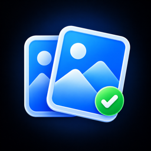
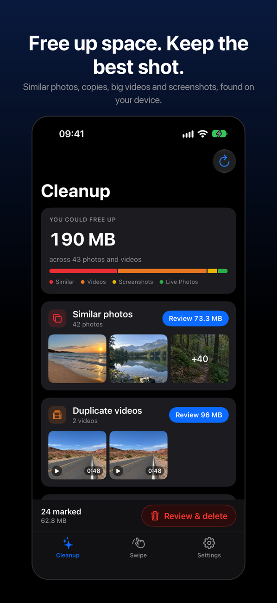
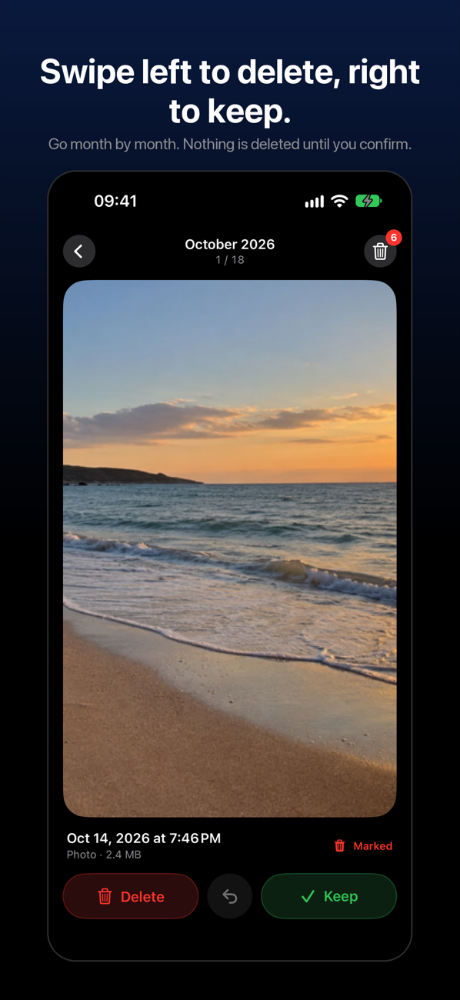
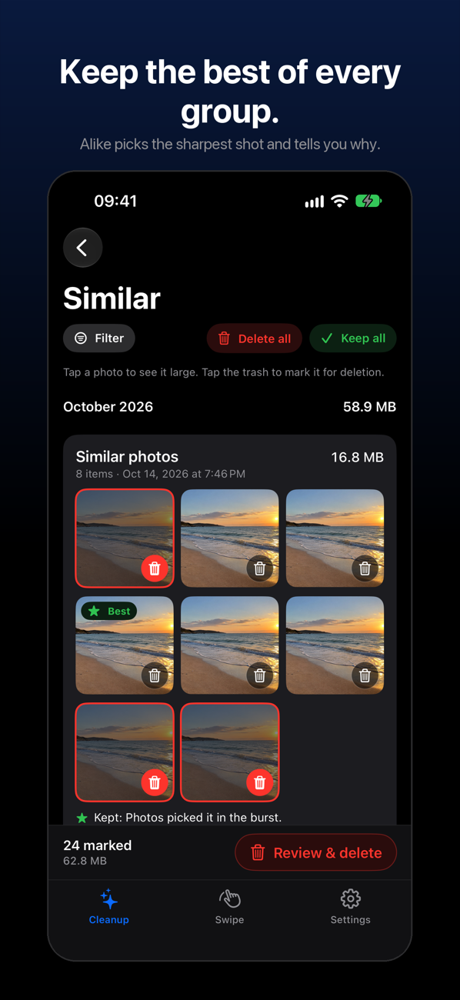
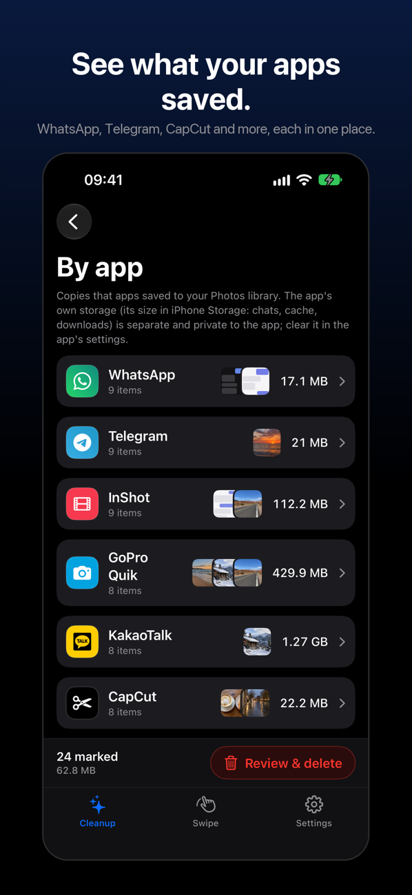
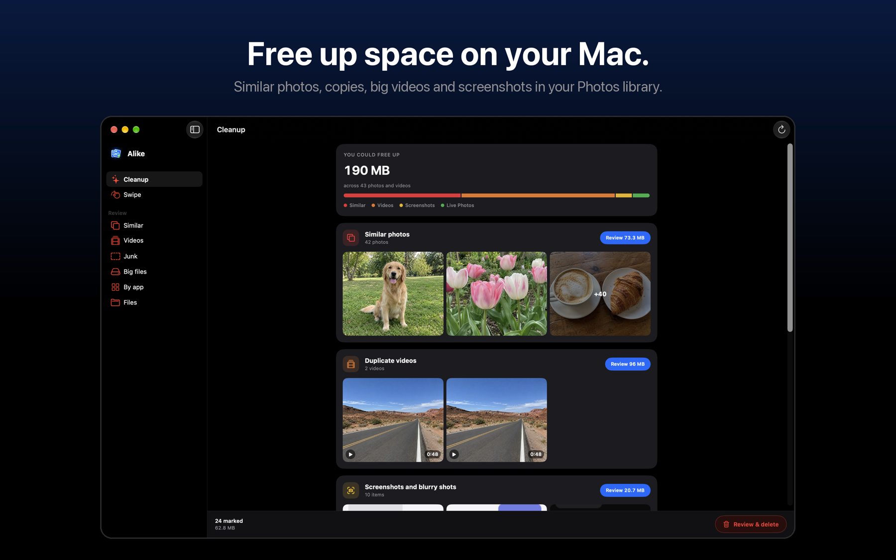

  

<h1 align="center">Alike Gallery Cleaner</h1>

  <strong>Free up space. Keep the best shot.</strong> 
  Find similar photos, duplicates, big videos and screenshots, and remove only what you approve. For iPhone, iPad and Mac.

  
  
  
  

---

> [!NOTE]
> This is a **community hub**, not a source repository. It hosts Alike's
> translations, support and issue tracker. The app's source code is closed
> and is never published here.

  
  
  
  

## What Alike does

- **Similar photos and duplicates.** Bursts, retakes and exact copies are grouped with the photo Alike suggests keeping and the reason: sharper, higher resolution, your favorite, the edited version.
- **Swipe.** Go through your library month by month: left to delete, right to keep, with undo.
- **By app.** See what WhatsApp, Telegram, CapCut and other apps saved to your Photos library.
- **Videos, screenshots, blurry shots and big files**, plus big files in folders you pick in the Files app.
- **A plan before anything goes.** Review every item and the space you get back, confirm once, and recover anything from Recently Deleted for 30 days.
- **iCloud aware.** Choose whether to clean only what is on this device or your whole iCloud library.

  

## Private by design

No account, no ads, no analytics and no network requests of its own. Photos are analyzed on your device. Read the [Privacy Policy](PRIVACY.md).

## Alike Pro

Scanning, marking, comparing and swiping are free. Removing items needs Alike Pro: weekly with a 3-day free trial, or yearly. One subscription works on iPhone, iPad and Mac.

## Languages

Alike speaks English, French, German, Spanish, Japanese, Korean, Brazilian Portuguese and Simplified Chinese. Every string is in [`languages/`](languages): the key is the English text, the value is the translation. Found a wrong or awkward phrase? Open a [translation issue](https://github.com/beyondthecode-bc/Alike/issues/new?template=translation.md).

## Support

See [SUPPORT.md](SUPPORT.md), write to [apps@beyondthecode.app](mailto:apps@beyondthecode.app), or open an [issue](https://github.com/beyondthecode-bc/Alike/issues/new/choose). Please don't attach personal photos.

---

  Made by <a href="https://beyondthecode.app">BeyondTheCode</a>. Alike branding and artwork are copyright 2026 MUREA VLAD-GEORGE PERSOANA FIZICA AUTORIZATA. All rights reserved. App names and logos shown in screenshots are trademarks of their owners.

